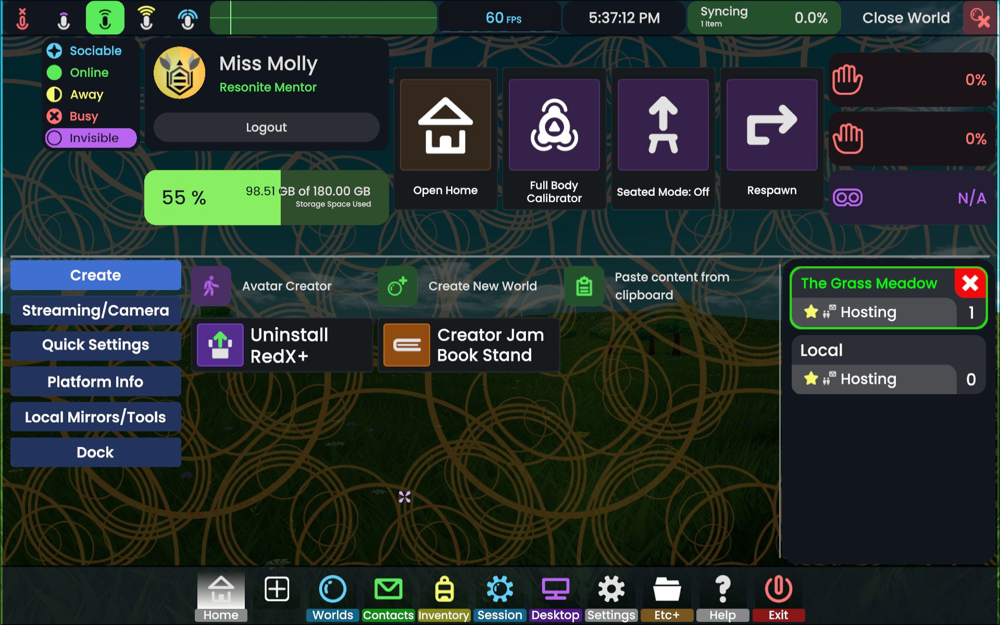

# HomeTabOverhaul

A [ResoniteModLoader](https://github.com/resonite-modding-group/ResoniteModLoader) mod that rebuilds Resonite's dash
**Home** screen: big everyday facets on top, fold-out tabs of facets below, and a **Dock** tab for rearranging the
dash's dock into folders.



> **Note:** this is a vibe-coded mod. It was made with [Claude Code](https://claude.com/claude-code), Anthropic's AI
> coding assistant: I described what I wanted and tested every step in-game, and Claude wrote the code.

## Features

Everything the mod builds is ordinary dash UI (facets, grids, buttons, drivers), so it's saved with your dash and you
can rearrange it in **UI Edit mode** like any other facet.

**First run**

Your current Home is kept as a dock tab called **Home (old)**, then the Home is rebuilt in the new layout.

**Top of the Home**

- Online status, your profile (log in / out) and storage
- Big tiles: Open Home, Full Body Calibrator, Seated Mode, and **Respawn** (warns you to save your work first; press
  twice)
- Left and right controller and headset batteries

**Tabs** (the column on the left of the bottom half)

| Tab | What's in it |
|---|---|
| Create | Avatar Creator, New World, Paste from clipboard, Install RedX+, Creator Jam Book Stand |
| Streaming/Camera | Camera, Stream Audio, Stream Video |
| Quick Settings | Nameplates, custom nameplates, Freeform Dash, 2FA, Debug, Earmuff, Edit Dash UI, **Dimness**, **Dash Colour** |
| Platform Info | Version, online users, cloud status, and the community events list |
| Local Mirrors/Tools | Install the Mirracle or Simple Reversible mirror (as dock tabs), spawn the Resonite mirror, a **local mirror** and a **local light** |
| Dock | The dock editor (see below) |

- In UI Edit mode, **New Tab +** adds a blank tab; the box under the list renames or deletes the open tab. The list
  pages when there are more tabs than fit.
- **Worlds You're In** sits on the right of the bottom half whichever tab is open.
- **Dimness** darkens everything you see (0–80 %), like SteamVR's dimming. Only you see it.
- **Dash Colour** tints the background of every dash screen.
- **Install buttons** (RedX+, mirrors) add a dock tab, then turn into **Uninstall …** (press twice).

**Local mirror and local light**

Spawned in front of you, facing you, in the world you're in. Only you can see them. Grab, scale, duplicate and delete
them like any object. Solid buttons underneath: a hand turns grabbing on (green) and off, a pin makes it follow you
(orange while pinned). The mirror has Low / Medium / High resolution; clicking the light's orb turns it on and off.

**Dock tab: rearranging the dock**

In UI Edit mode:

- ▲ ▼ move a tab along the dock.
- **New Folder +** makes a dock folder. **Into folder / Next folder / Take out** move tabs in and out. A folder is a
  dock tab of its own that shows a big button for each tab inside.
- **New Tab +** makes an empty dock tab to fill with facets.
- Type in a name to rename a tab or folder you made; click its icon or colour swatch to choose a new one.
- **Delete** (press twice) removes a tab or folder you made; a folder's tabs go back on the dock.

Folders, the order and your tabs are saved with the dash and keep working without the mod. Only a full dash reset in
the game resets them.

**Desktop UI editing**

In UI Edit mode on desktop, drag a facet to move it, or drag its edge or corner to resize it.

## Installation

1. Install [ResoniteModLoader](https://github.com/resonite-modding-group/ResoniteModLoader) (RML 5.x).
2. Download `HomeTabOverhaul.dll` from [Releases](../../releases) and put it in `rml_mods` in your Resonite folder.
3. Start Resonite. The log should contain `[ResoniteModLoader/HomeTabOverhaul] Patched the dash`.

## Settings

Change these in the RML mod settings or in `rml_config/HomeTabOverhaul.json`. They apply straight away.

| Setting | Default | What it does |
|---|---|---|
| `enabled` | true | Off: **Home (old)** becomes the Home again (or, without it, the Home loses its tabs). On again: the new Home comes back as you left it. Dock tabs and folders stay either way. |
| `home_tabs` | true | Off: one Home page with the game's facets in their usual places and the mod's around them. Each layout keeps its own changes when you switch. |
| `show_dividers` | true | The divider lines between the Home's top, its tabs and the side area. |

## Good to know

- **Cloud items.** Community Events and Worlds You're In are loaded from their public items when a Home is built; the
  install buttons load RedX+, the mirrors and the book stand when you press them. Like anything placed in your dash,
  they run their own code there, and the version loaded is the one their creators have published at that moment.
- **Before uninstalling the mod,** turn `enabled` off so Home (old) is your Home again.

## If a Resonite update breaks it

HomeTabOverhaul is built to fail safely. At startup it checks that every part of the game it relies on is still there;
if not, it applies no changes and logs a warning starting with *"The engine's dash has changed"*. If anything goes
wrong while running, only that part of the mod (the Home, desktop dragging, or the buttons) switches itself off for
the session. What it already built is plain dash UI and keeps working.

## Building from source

Requires the .NET 10 SDK. The project uses [Remora.Resonite.Sdk](https://github.com/Remora/Remora.Resonite.Sdk)
with `ResoniteTargetModLoader=ResoniteModLoaderStandalone` (classic RML) and builds against publicized assemblies.

```
dotnet build src/HomeTabOverhaul
```

The build copies `HomeTabOverhaul.dll` into `<Resonite>/rml_mods/`, so close Resonite first. Set `ResonitePath`
if Resonite isn't in the default Steam folder.

## Credits

The install buttons and built-in facets load public Resonite items made by others, including RedX+ by Adam
(AdamSkI2003) and the Mirracle mirror (dock screen base by badhaloninja). None of their contents are included here.

## License

[MIT](LICENSE) © 2026 Miss Molly
